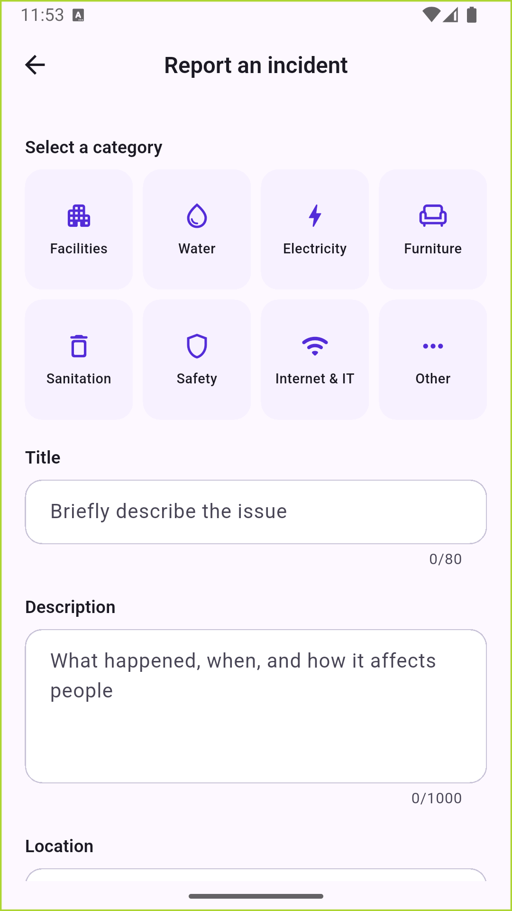
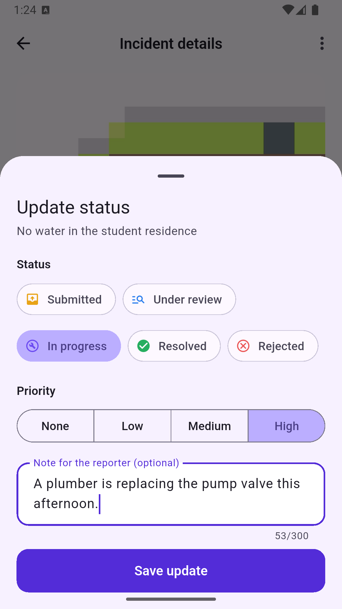
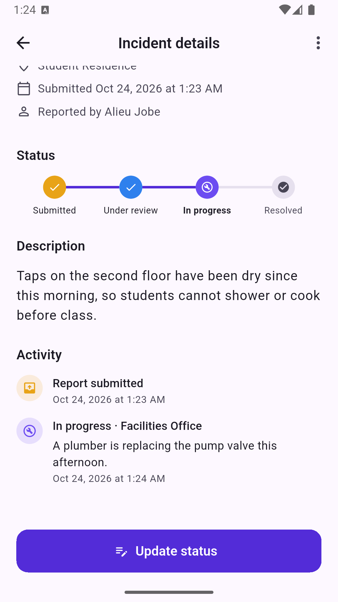
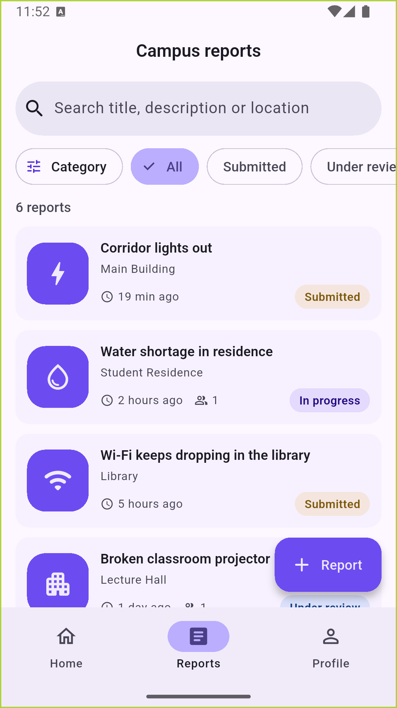

# CampusFix

**[Watch the 7-minute demo](https://youtu.be/VMkwPiMMgJY)**

CampusFix is a Flutter mobile app for the African Leadership University community. Students report campus problems such as broken facilities, water shortages, power outages, damaged furniture, sanitation issues and safety concerns. Campus staff review the reports, set priorities and post progress until each one is resolved.

## Features

**For students**
- Sign up with an `@alustudent.com` or `@alueducation.com` address; email verification is required before the app opens
- Report an incident with a category, title, description, campus location and an optional photo
- Report anonymously, or keep a report private so only staff can see it (safety reports are always private)
- Browse campus reports with live search and status/category filters
- Follow each report on a status timeline: Submitted → Under review → In progress → Resolved (or Rejected with a reason)
- Tap "This affects me too" instead of filing a duplicate
- Edit or withdraw your own report until staff start working on it

**For staff**
- See every report, including private and anonymous ones (staff can see who filed an anonymous report)
- Update status and priority, and leave notes that reporters see on the timeline
- A campus-wide dashboard showing new, active and resolved counts

**For admins**
- Grant or remove staff and admin access from inside the app

**Safeguards against misuse and privacy leaks**
- Photos are compressed and stripped of EXIF metadata (including GPS) on the device before upload
- The server enforces a limit of one report per minute per user
- Every permission is enforced by Firebase Security Rules, not only by the UI

## Tech stack

| Concern | Choice |
| --- | --- |
| UI | Flutter 3.47, Material 3, light and dark themes |
| State management | Riverpod 3 (`Provider`, `StreamProvider`, `Notifier`, `AsyncNotifier`) |
| Navigation | go_router with auth-aware redirects and a `StatefulShellRoute` for the tabs |
| Backend | Firebase Authentication, Cloud Firestore, Firebase Storage |
| Testing | flutter_test, fake_cloud_firestore, Firestore emulator rules tests |

## Architecture

Code is organised by feature. Each feature is split into layers:

```
lib/
├── main.dart, app.dart          # Firebase bootstrap, MaterialApp.router
├── core/                        # theme, router, shared widgets, utils, Firebase providers
└── features/
    ├── auth/                    # sign in/up, verification, user profile & roles
    ├── incidents/               # reporting, browsing, details, staff updates
    ├── admin/                   # role management
    └── profile/                 # profile and "my reports"
        ├── domain/              # plain Dart models & business rules (no Flutter)
        ├── data/                # repositories: the only code that talks to Firebase
        ├── application/         # Riverpod providers & controllers
        └── presentation/        # screens and widgets
```

Widgets never call Firebase directly. They read providers and call controller methods. Controllers delegate to repositories, and repositories own every Firestore and Storage call. Because Firestore streams back into `StreamProvider`s, a status change by staff shows up immediately on the student's detail screen, dashboard and lists.

## Firestore data model

```
users/{uid}
  email, displayName, role: student | staff | admin, createdAt, lastReportAt

incidents/{incidentId}
  title, description, category, location
  status: submitted | underReview | inProgress | resolved | rejected
  priority: null | low | medium | high
  reporterId, reporterName (null if anonymous), isAnonymous, isPrivate
  photoUrl, photoPath, upvoterIds[], createdAt, updatedAt

incidents/{incidentId}/updates/{updateId}     # status timeline
  status, note, authorId, authorName, createdAt
```

Photos sit behind a `PhotoStore` interface with two implementations:

- **Firebase Storage**: `incidents/{reporterUid}/{incidentId}.jpg`, protected by `storage.rules`. Used with the emulators, or with `--dart-define=USE_STORAGE_BUCKET=true` on a project that has a bucket.
- **Firestore**: `incidentPhotos/{incidentId}` holds the compressed image (under 900 KB) as bytes. The live project uses this because Cloud Storage buckets now require the paid Blaze plan.

## Security

`firestore.rules` and `storage.rules` enforce the access model on the server:

- Only verified ALU email accounts can read or write anything.
- New accounts are always `student`. Only an admin can change a role, and never their own.
- Students read public reports and their own; staff read everything.
- Only staff change `status`/`priority`, and each change must come with a matching timeline entry.
- Reporters can only edit or delete while a report is still `submitted`.
- Report fields are validated (lengths, enums, no impersonated names, safety ⇒ private, rate limit).

## Getting started

Prerequisites: Flutter 3.47+, a Firebase project, the Firebase CLI and the FlutterFire CLI. The free Spark plan is enough; a Storage bucket (Blaze plan) is optional.

```bash
git clone https://github.com/Jobealieu/campus-incident-reporting.git && cd campus-incident-reporting
flutter pub get
flutterfire configure            # generates lib/firebase_options.dart
firebase deploy --only firestore:rules,firestore:indexes
flutter run                      # add --dart-define=USE_STORAGE_BUCKET=true and deploy storage if you have a bucket
```

In the Firebase Console, enable **Email/Password** sign-in. To create the first admin, sign up in the app, then set `role` to `admin` on that user's document in `users/` from the console. After that, admins manage roles in the app.

## Testing

```bash
flutter analyze
flutter test                     # 40 unit, repository and widget tests

# 35 security-rules tests (needs Java 21+)
firebase emulators:exec --only firestore --project demo-campusfix "flutter test test_rules"
```

To try the app without touching the live project, start the local emulators and point a debug build at them:

```bash
firebase emulators:start --only auth,firestore,storage --project demo-campusfix
flutter run --dart-define=USE_FIREBASE_EMULATORS=true
```

## Demo

- Demo video: https://youtu.be/VMkwPiMMgJY

| Report form | Staff update | Status timeline | Browse and filter |
| --- | --- | --- | --- |
|  |  |  |  |

More screens are in [docs/screenshots](docs/screenshots).
